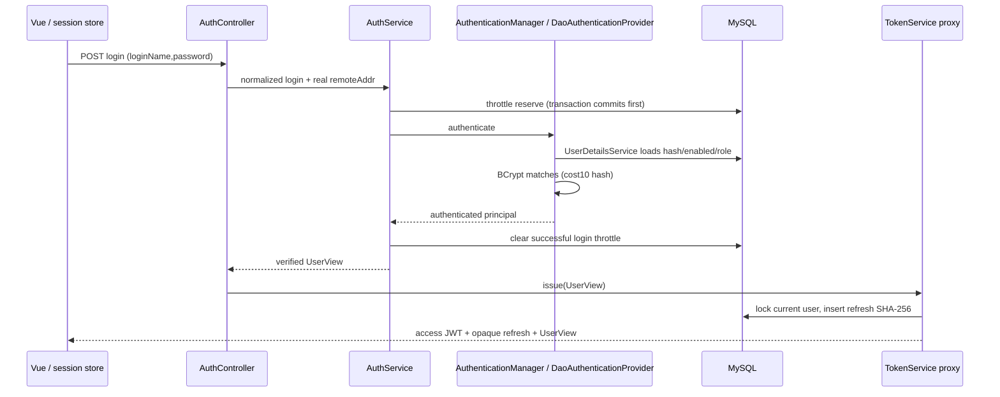
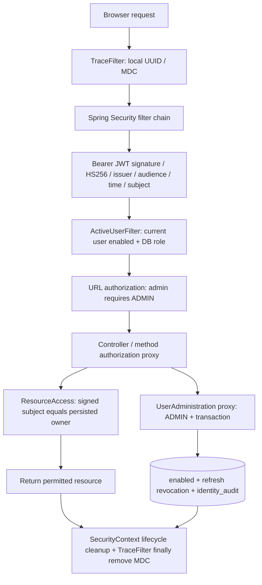
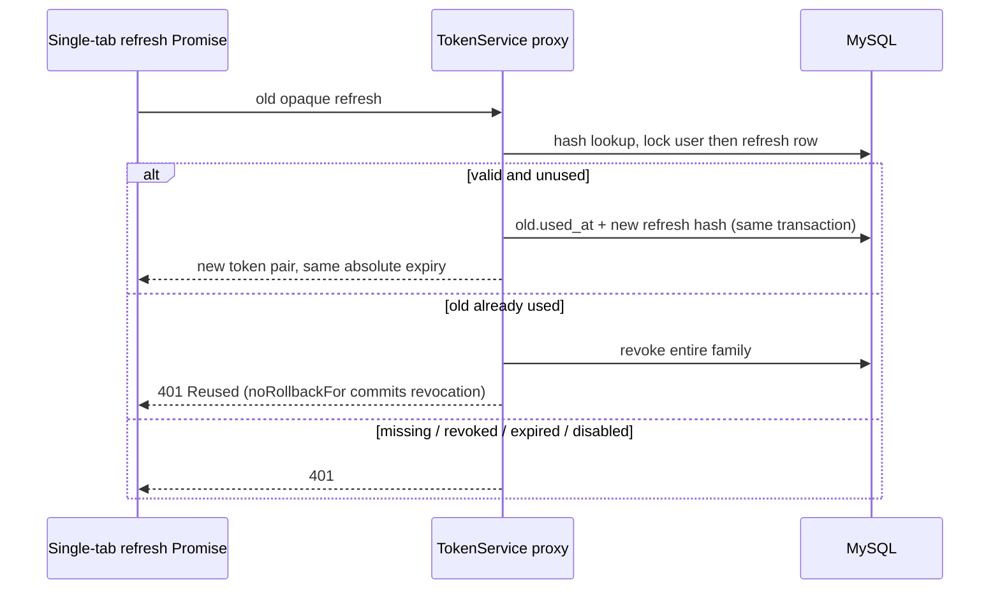

# 第一周安全链路：按现有实现讲解

基线：566e5c0（业务实现与9a74c0f一致），复核2026-11-16。这里只描述Day 1–6的身份系统；订单、支付、消息链路仍是计划。

## 登录和请求认证是两条入口

登录名ASCII规范化为小写，密码不trim，BCrypt最多72字节。用户名/密码认证在控制器调用的AuthenticationManager完成，并不是表单登录过滤器。公开注册固定BUYER，JSON不接受额外role/id字段。失败登录预算在验证前独立提交，因此认证异常不会回滚计数。未知账号与口令错误的code/message相同，traceId各异；没有证明时间恒定。

图中省略框架内部其他过滤器，不暗示每个请求都经过所有业务分支。public login/register/refresh/logout可以不携带Bearer，health公开且不含详情。无效Bearer即使发向公开接口也可能先被认证过滤器拒绝。没有token则受保护接口401；有身份但无角色/归属则403；本地trace响应头与错误体对应，不把trace当用户身份。

## 资源授权与事务边界

`ResourceAccess.requireOwner`必须经注入Bean代理调用，参数来自持久化资源的owner。当前生产实例为本人用户查询；订单owner验证仅存在AuthorizationIT的测试表和接口。不能声称生产订单越权已经覆盖。管理员禁用的URL和服务方法都有角色约束；测试入口绕过admin URL仍被方法授权拒绝。

`UserAdministration.disable`的本地事务包含用户禁用、全部refresh撤销与审计插入。审计actor来自JWT认证上下文，伪造query/header不生效。CHECK故障注入证明审计失败业务回滚；不把普通日志等同可靠审计。权限检查基于本次读取的用户状态，未声称对所有并发角色变更提供全局线性化保证。

## refresh为什么需要数据库

access有效期300秒，校验容差30秒；refresh绝对期限从登录起7天，旋转不延期。退出撤销refresh family，旧access最多仍有效330秒；禁用用户后，下次Bearer请求也查询并拒绝该用户。重复旧refresh触发全族撤销，因此客户端必须串行刷新。真实并发测试的一方成功、一方401，成功方refresh也因另一方重放而失效。

前端access在闭包内存，refresh在sessionStorage；单标签页Promise合并刷新，较晚到达的旧401不会再次旋转。epoch拒绝退出前发出、退出后到达的旧响应。sessionStorage不防XSS，复制标签页可能重放；刷新网络超时可能已在服务端完成，客户端清除身份后重新登录，不能无限重试。

## 代码入口与证据

| 需要解释的路径 | 实现 | 已有验证 |
|---|---|---|
| 公开登录、过滤链 | SecurityConfiguration、AuthController/AuthService | UserAuthenticationIT |
| 当前角色和enabled | ActiveUserFilter、UserRepository | TokenLifecycleIT、AuthorizationIT |
| 轮换、锁序、重放提交 | TokenService | TokenLifecycleIT的并发与重放 |
| 角色与owner | ResourceAccess、IdentityController | AuthorizationIT |
| 审计回滚 | UserAdministration、V4 SQL | AuthorizationIT的CHECK失败注入 |
| 线程请求状态 | TraceFilter、Spring Security | TraceFilterTest、匿名/已认证请求负例 |
| 浏览器异步竞争 | session.ts、router.ts | session.test.ts、router.test.ts、LoginPage.test.ts |

Java路径均在backend/trade-service/src/main/java/dev/commerceflow/trade/identity；测试在src/test/java的infrastructure或identity包。历史实测见[Day 4](../progress/day-04.md)、[Day 5](../progress/day-05.md)、[Day 6](../progress/day-06.md)，当日复盘见[Day 7](../progress/day-07.md)。

参考与项目实际版本对应的[Security 6.5认证架构](https://docs.spring.io/spring-security/reference/6.5/servlet/authentication/architecture.html)及[方法授权](https://docs.spring.io/spring-security/reference/6.5/servlet/authorization/method-security.html)。框架负责SecurityContext生命周期；本项目新增MDC由finally清理，未实现异步线程传播或分布式追踪。
