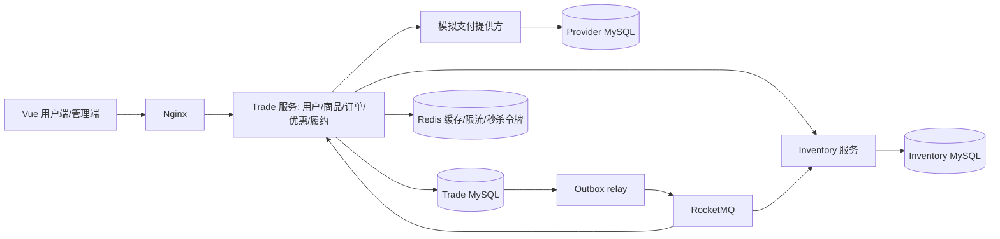
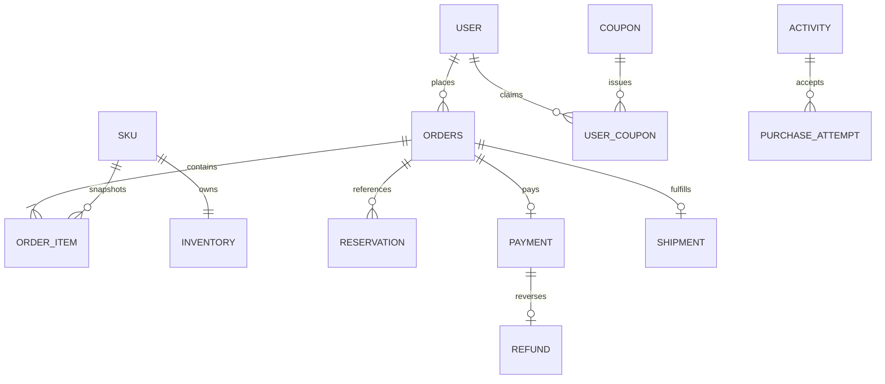

# CommerceFlow：分布式电商交易与订单履约平台

配套：[56 天每日计划](./CommerceFlow-Java-56天每日计划.md) · [面试与 AI 协作手册](./CommerceFlow-Java-面试与AI协作手册.md)。制定日期：2026-11-15。本文所有验收与性能指标均为未来目标。

## 定位和范围

用一条真实可解释的交易链路展示 Java 后端能力：商品→库存预占→订单优惠→模拟支付→出库发货→签收，另有取消、退款和秒杀支线。面向 Java 业务后端、初中级微服务岗位；不能保证覆盖所有招聘要求，也不能替代工作经验、基础题和算法训练。

按已有后端基础、每天 4–5 小时、每周 6 天开发加 1 天复盘安排，约 220–250 小时。Java/Spring 完全陌生则先加 1–2 周入门，或整体延长至 10–12 周。每日另含 30–45 分钟基础学习，不靠 AI 跳过理解。

必须交付：Vue 用户端与管理端、交易闭环、支付关单竞争测试、数据库防超卖、可靠消息、有限服务拆分、秒杀实验、Docker/CI、实测报告。延后：多商家、复杂运费税费、真实支付、部分退款、真实物流、推荐搜索引擎、K8s、分库分表。

## 版本与架构

采用 Java 21、Spring Boot 3.5.x；Cloud 对应 2025.0.x，而非任意最新版本混搭。Day 1 查支持状态与安全修复，锁定精确 BOM/补丁和镜像；兼容不等于仍在免费维护期。参考 [Spring Cloud 官方兼容表](https://spring.io/projects/spring-cloud/) 和 [支持版本](https://github.com/spring-cloud/spring-cloud-release/wiki/Supported-Versions)。

MyBatis/MyBatis-Plus、MySQL 8、Redis 7 或 8 固定一个版本、RocketMQ 固定 Broker/客户端兼容组合。Nacos 客户端及 Spring Cloud Alibaba 适配版本必须先做启动/注册验证，不关闭兼容检查硬凑版本。治理选 Resilience4j，不同时堆 Sentinel。前端 Vue 3 + TS + Vite + Router + Pinia + Element Plus，图表按需用 ECharts。

前四周模块化单体与独立模拟支付提供方；第五周拆出 inventory-service，保留 trade-service 内订单、优惠券和履约，payment-simulator 独立存储。三个服务足够演示远程失败与最终一致性，业务模块不要求各自微服务化。身份模块暂留 trade，内部服务仍验证可信调用身份与权限，不能信任公网传入用户头。

可共享 MySQL 实例以节省资源，但服务独立 schema、独立账号，禁止跨服务表 JOIN/直接写库。Nacos 发现、OpenFeign 调用、超时/重试/熔断从第五周加入。提供 core/full Compose profile；完整环境资源以实测记录，不承诺低配置机器全部常驻。

## 关键规则：必须先写清楚再编码

### 身份和价格

BCrypt、短期 access token、可撤销 refresh session 和旋转刷新；退出撤销 refresh，access 的剩余有效窗口明确记录，敏感动作额外检查用户状态。JWT 校验签名、算法、issuer/audience/到期。管理员与买家分权限，买家只能查自己的订单/退款，日志脱敏。登录限流按账号与来源组合，避免单一 IP 误伤。

所有价格由服务端计算，订单保存 SKU 名称/单价/优惠/地址快照。金额用 long 分或严格 BigDecimal 换算后入库，校验溢出，API 金额使用字符串。只做单币种 CNY、固定运费和每单一张满减券；不接受前端应付金额。

### 库存与订单

库存定义 physical 为未发货实物数量，reserved 为已预占数量，available=physical-reserved，始终 0<=reserved<=physical。预占增加 reserved；取消减少 reserved；发货同时减少 physical 与 reserved。支付成功只确认预占，不重复扣实物库存。发货前全额退款释放预占；发货后退款须模拟退货验收后才恢复实物库存。

预占以 `(order_id, sku_id)` 唯一，状态 RESERVED/COMMITTED/RELEASED/SHIPPED，动作条件更新。多 SKU 按固定 SKU 顺序锁定/更新，全成功或全回滚。MySQL 条件更新检查 affected rows 防超卖；Redis 缓存不是库存事实源。

单体阶段订单、库存、券预占与 outbox 同事务。订单幂等键范围用户+操作+key，保存请求摘要与结果；同键不同内容拒绝。退款/支付另有业务唯一键，不能只依赖 Redis 去重过期时间。

### 支付、关单与退款

模拟提供方独立保存支付意图、支付结果与退款账本，支持幂等创建、查询、关闭、退款。回调验签、校验订单/金额/币种/支付流水，提供重复、延迟和乱序注入；测试签名密钥不能进入仓库。

订单 NEW→RESERVING→PENDING_PAYMENT→PAID→FULFILLING→SHIPPED→COMPLETED；取消从允许状态进入 CLOSING，再 CLOSED。退款使用独立退款状态机，不能把支付、履约和退款压成一个任意可改的 status。

关单先进入 CLOSING，向提供方幂等关闭支付意图；提供方以原子状态转换裁决支付与关闭。如果已支付，查询确认并转 PAID；确认 CLOSED 才释放库存和优惠券。超时/网络错误表示未知，维持 CLOSING 重试对账，不能直接释放。CLOSING 收到可信成功回调必须走同一仲裁。支付意图的创建也需要固定 ID 与关闭墓碑，避免取消后迟到创建产生新支付入口。

如果测试注入“本地已关闭却发现外部扣款”，进入异常对账/自动退款待处理，不能复活已释放库存的订单。记录处置结果并告警。普通定时任务不自动关闭已 PAID 订单。

退款仅全额，每订单最多一次成功退款。先持久化退款申请，再幂等请求提供方；超时查询原退款，不生成新退款号。退款成功和库存恢复是独立可重试步骤；未发货与已退货的库存动作不同。重复退款回调不能再次加库存。

### 优惠与履约

券 AVAILABLE→RESERVED→USED，确认支付核销，关单释放；过期释放后为 EXPIRED，不能重新可用。退款默认不退券，并在产品规则中说明。活动发行上限、用户领取唯一键和订单券绑定必须有数据库约束。

履约只做拣货确认、模拟物流单、发货、签收和退货验收。退款申请与发货竞争锁订单履约状态，退款受理后禁止发货；若发货先成功则切换退货退款流程。每个物流事件有唯一 ID，重复签收无副作用。

## 可靠消息与服务拆分

选择业务事务 + Outbox 为主方案。relay 发送确认后标记；发送成功但标记前崩溃会重复投递，消费者 inbox 去重与本地业务更新同事务。ACK 仅在事务成功后；重试耗尽进入死信，人工重放也走幂等。事件包含 eventId、aggregateId、version、occurredAt、schemaVersion 和 traceId；不能假设不同 topic 全局有序。

RocketMQ 事务消息可做小实验对比，但不要求同时维护两套主链路。官方明确事务消息是最终一致性机制，不能把它理解成跨服务 ACID。[事务消息](https://rocketmq.apache.org/docs/featureBehavior/04transactionmessage/)；[消费重试](https://rocketmq.apache.org/docs/featureBehavior/10consumerretrypolicy/)。

拆分后：trade 持久化 RESERVING 和 ReserveRequested → inventory 本地事务预占+outbox → trade 接受 Reserved 后进入待支付。失败则取消券预占并关闭。取消与迟到 Reserve 交错时，inventory 必须保存 RELEASED 墓碑或操作版本，迟到预占不得重新占库存；重复命令返回既有结果。

补偿是新业务动作而非远程 rollback。每个中间态有超时扫描、重试次数、最后错误和人工处理入口；禁止靠一次 HTTP 返回决定永久丢弃订单。对账比较订单、预占、支付三类状态，补发命令前再次检查状态。

## 秒杀：先正确，再测吞吐

独立活动限量和每用户一次资格；Redis Lua 原子校验活动时间、限购标记和令牌，使用相同 hash tag 避免 Cluster 跨槽。令牌不是实物库存，数据库仍校验活动额度和 SKU available。

可靠流程：先在 MySQL 记录唯一 purchase_attempt，再执行 Lua 按 attemptId 预扣；成功后事务写 attempt 状态和 outbox，返回受理号而非“下单成功”。worker 异步创建订单，用户查询结果。Lua 成功后进程崩溃，由扫描器结合 Redis attempt 标记恢复；标记在对账完成前不得随意过期。

确定失败后按 attemptId 只返还一次令牌，并释放资格；结果未知先查询，不能盲目 INCR。Redis 数据丢失时暂停活动入场，根据数据库活动占用及待处理 attempt 对账重建，生成新 epoch，拒绝旧 epoch 命令；不提供重置满库存按钮。保守少卖可接受，不能以超卖换可用性。

活动 token 生命周期、取消是否回补、未付款名额是否再次售卖写为固定规则：本期未付款关闭后允许回补，但要在数据库释放确认后幂等回补。压测分别记录受理率、最终成单率与失败原因。

## 数据模型草案

图中跨服务关系是逻辑关联，不建跨服务数据库外键。本地同服务关系可以用 FK。主要约束：user_coupon(user,coupon) 唯一；reservation(order,sku) 唯一；payment(provider,transaction_id) 唯一；refund(order) 唯一；inbox(consumer,event_id) 唯一；attempt(activity,user) 唯一；idempotency(user,operation,key) 唯一。

索引从查询验证：orders(user_id,created_at,id)、orders(status,expires_at,id)、outbox(status,next_run,id)、reservation(order_id,status)、refund(status,next_run,id)。订单明细/地址保存快照；金额、数量有范围校验。不要仅依赖 ORM 标签，迁移后验证实际索引和约束。

## 验收实验与交付

| 编号 | 必须运行的实验 | 不变量/证据 |
|---|---|---|
| T01 | 用户 A 查/改 B 订单、退款，买家调管理员 API | 拒绝且数据不变 |
| T02 | 同键重复下单、同键不同内容 | 一个订单或明确冲突 |
| T03 | 100–500 并发抢有限库存 | 不超卖；余额与流水可对账 |
| T04 | 多 SKU 中一个不足 | 单体全回滚；拆分补偿终态正确 |
| T05 | 重复/乱序/伪造/金额错误支付回调 | 一次有效支付转换，无重复核销 |
| T06 | 支付与超时关闭同时发生 | 最终已付且持有库存，或已关且无扣款/已退款 |
| T07 | 全额退款重试、退款与发货竞争 | 一次退款，库存恢复不重复 |
| T08 | DB 成功、发送前崩溃；发送后标记前崩溃 | 最终送达，重复消费无额外影响 |
| T09 | 消费提交后 ACK 丢失、死信重放 | inbox 与业务一致 |
| T10 | 取消先到、预占后到 | 释放墓碑阻止库存重新占用 |
| T11 | Lua 成功后崩溃、Redis 重启/数据丢失 | attempt 可恢复；重建不重复发令牌 |
| T12 | 商品修改、缓存删除失败、旧读晚回填 | 有界陈旧与补偿，结算不信缓存价 |
| T13 | 库存服务延迟/不可用、Nacos 重启 | 不伪造成功；中间态最终收敛 |
| T14 | RC/RR 两事务可见性、更新竞争 | 记录实际读值与锁等待 |
| T15 | 大订单表慢 SQL 和 JVM 诊断 | 可复现原始结果和优化前后对比 |
| T16 | 新机器部署、备份恢复、全链路浏览器操作 | 无私人配置也可复现 |

缓存采用 Cache Aside、提交后失效+补偿+TTL；TTL 是陈旧上界设计的一部分，必须考虑并发旧值回填，不宣称删缓存就强一致。交易价格在数据库重新校验。热点缓存加随机 TTL、请求合并，空值缓存限时；无测量不引入复杂缓存。

测试用 JUnit5/Mockito 测纯规则，Testcontainers 用真实 MySQL/Redis 测约束与 Lua，MQ 集成测试使用真实 Broker 容器或独立 Compose 测试环境，不能用 mock 声称验证了 ACK/重投。前端 Vitest 与 Playwright 覆盖关键路径。

压测准备 1万/10万/按资源允许100万订单，100–500 并发按梯度提升。报告含 commit、CPU/内存、版本、数据分布、预热、时长、吞吐、P50/P95/P99、预期业务拒绝与5xx分别统计、GC/锁/DB池等待。保留脚本与原始数据，不预填 QPS。JFR/Arthas 故障注入仅在本地实验配置开启。

Micrometer→Prometheus→Grafana 观察请求、订单中间态积压、outbox延迟、死信、JVM/线程池/连接池；trace 跨 HTTP/MQ 传播，不将 userId/orderId 当高基数指标标签。Actuator/诊断接口仅内部可访问。

## 发布路线和仓库

第1周基础和身份；第2周商品库存与订单；第3周支付/关单/退款/履约；第4周消息可靠性；第5周拆服务与治理；第6周秒杀；第7周性能与稳定性；第8周部署、录屏与面试。

目录建议：backend/{trade-service,inventory-service,payment-simulator,contracts}、web、deploy、docs、scripts、tests。contracts 仅共享 DTO/事件契约，不共享实体 Repository 跨服务写库。迁移与 seed 显式执行，启动不自动清库。

每天建议2–4个完整提交，复盘日可1个或无提交，预计100–150个实际提交；不补造日期。README包含架构、启动、账号、实测、测试与边界。演示以合成数据和受限管理员账号进行，真实支付不接入。

最终录屏：买家下单→模拟支付→管理员发货→签收；再演示重复回调、支付关单竞争、退款对账、秒杀最终结果、MQ重投与监控。若第4周核心仍不正确，削减图表和通用管理，推迟拆分，延长周期；不能用仅加入依赖替代真正的分布式实验。

建议在独立 commerceflow-java 目录建立项目与 Git 仓库；当前总览保存计划。本次交付仅为计划文档。
